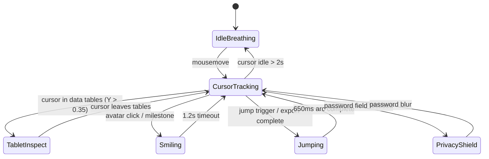

# Phase 1: Data Model & State Architecture
## Feature: Immersive Real-Sync 3D Character Experience & Spatial HUD

---

### 1. Character State Machine Entities

#### Entity: `CharacterState`
| Property | Type | Description |
| :--- | :--- | :--- |
| `currentAction` | `'idle' \| 'tracking' \| 'smiling' \| 'jumping' \| 'waving' \| 'inspecting' \| 'privacy'` | Active animation state |
| `activeAngle` | `'left' \| 'center' \| 'right' \| 'down'` | Active visual pose keyframe |
| `yawDegree` | `number` ($-26^\circ$ to $+26^\circ$) | Horizontal head and body turn angle |
| `pitchDegree` | `number` ($-12^\circ$ to $+12^\circ$) | Vertical head tilt angle |
| `jumpOffsetY` | `number` ($0$ to $-36\text{px}$) | Vertical jump elevation displacement |
| `squashStretch` | `{ scaleX: number, scaleY: number }` | Dynamic squash-and-stretch scale factors |
| `glarePosition` | `{ x: number, y: number }` (0–100%) | Specular light reflection coordinates |
| `isSparkling` | `boolean` | Eye twinkle effect toggle |
| `speechBubble` | `{ text: string, type: 'advice' \| 'celebration' \| 'privacy' }` | Current dialogue speech bubble |

---

### 2. HUD Viewport State Entity

#### Entity: `SpatialHudState`
| Property | Type | Description |
| :--- | :--- | :--- |
| `viewMode` | `'hero_spatial' \| 'workspace'` | Full cinematic spatial showcase vs two-panel engineering workspace |
| `activeChapter` | `StepNumber` (1 to 5) | Active engineering chapter |
| `isSoundEnabled` | `boolean` | Web Audio sound synthesis toggle |
| `telemetry` | `HudTelemetry` | Telemetry readouts (Signal, Engine, Ingredient, Sanction) |
| `cameraParallax` | `{ x: number, y: number }` | Mouse parallax offsets for background structures and reticles |

---

### 3. Audio Telemetry State Entity

#### Entity: `AudioFxEvent`
| Event Type | Sound Synthesis Profile | Trigger |
| :--- | :--- | :--- |
| `CLICK` | 800Hz sine burst with exponential decay ($40\text{ms}$) | Button click / card select |
| `HOVER` | 1400Hz to 1800Hz triangle bleep ($50\text{ms}$) | Reticle coordinate lock |
| `JUMP_CHIME` | Rapid ascending arpeggio ($C_5, E_5, G_5, C_6$) | Jump trigger / calculation success |
| `CHAPTER_CHIME` | Resonant chord with low-pass filter | Chapter switch |
